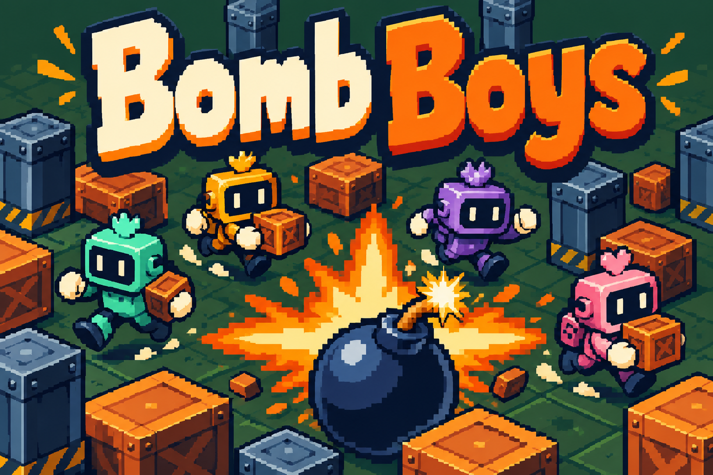

# Bomb Boys branding



Official name: **Bomb Boys**.

## Art direction

Cream and orange pixel lettering over a moss-green arena with steel pillars, brick crates, four colored couriers and a cross-shaped blast.

The existing bomberman-clone/documentation/multiplayer-draw.png capture and bomberman-clone/src/content/art.js establish the green floor, steel pillars, brick crates and original courier shapes. The screenshot was viewed for visual context only. The final image was generated from a text prompt without supplying, cropping, tracing or compositing a screenshot.

## Asset and usage

- File: `docs/images/game-logo.png`.
- Purpose: README splash illustration and game-directory thumbnail.
- Generation: built-in OpenAI image generation through the existing Codex session. No API key, separately billed API or external image service was used.
- Format: opaque PNG, 1536 by 1024 pixels.
- Keep the complete title visible when displaying or resizing the image. The official name excludes "Multiplayer"; multiplayer capability remains documented separately where applicable.

## Final generation prompt

```text
Use case: logo-brand. Create a completely original landscape 3:2 pixel-art arcade splash illustration from scratch. Exact and only title "Bomb Boys", these exact two words in very large playful cream and orange block lettering with a deep navy outline in the upper half. Make title readable at 240px thumbnail width. Below it, four small original workshop courier robots in mint, amber-orange, violet and rose rush between chunky orange-brown brick crates and steel-blue pillars on a dark moss-green arena floor. Their shapes are compact and square, dark rectangular face visors with tiny ivory eyes, little colored crown details, dark boots and ivory hands. One large round dark navy bomb with warm tan fuse and ivory spark anchors the foreground, with a stylized orange-and-gold cross-shaped blast behind it. These are original friendly robot couriers, not characters from any existing franchise. Crisp bold pixel illustration, strong silhouettes, rich navy and green shadows, bright warm explosion accents, playful energy, deliberately limited palette. The actual game has dark green tile floors, steel pillars, orange crates, and four original colored couriers. New promotional scene only; no screenshot, HUD, score or game UI. No watermark, no other lettering, never Multiplayer, no copied character design. Opaque background and safe margins around title.
```
